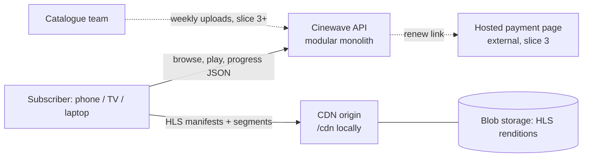

# Architecture

## Style and why
Advisor output (traits: MediaDelivery, ReadHeavy, PersonalData, MoneyMovement, SeveralBusinessAreas, SmallTeam):

### Recommendation: ModularMonolith

Several business areas need clear boundaries, but one deployment and one database keep it cheap to run and easy to hand over.

#### Patterns
- **AppendOnlyLedger**: Record debits and credits as new entries instead of overwriting a balance, so money always balances and can be traced.
- **IdempotencyKeys**: Every money-moving request carries a key, so a retry can never pay twice.
- **TransactionalOutbox**: Save the change and the event in one transaction, so other parts never miss a payment.
- **CachedReadModel**: Serve searches from a separate, cached read side so reads never slow down writes.
- **Cdn**: Large files go through a CDN, never through your application servers.
- **PersonalDataProtection**: Collect the minimum, encrypt it, log who read it, and be able to delete it (POPIA/GDPR).

#### Closest reference systems
- E-commerce shop (similarity 0.57): Modular monolith with a separate catalogue read model (document store, cache, CDN); extract search as a service when traffic grows.
- Photo-sharing social feed (similarity 0.57): At global scale: media, graph, feed and notification services, a CDN for images, and feeds pre-built per follower (fan-out on write) with a pull fallback for very popular accounts.
- Video or music streaming (similarity 0.43): Microservices with a CDN for the media itself and an event stream for playback events.

#### Risks to watch
- Modules decay into a big ball of mud unless boundaries are enforced by tests (no cross-module database access).
- Floating-point money or update-in-place balances. Use decimal and ledger entries only.

#### Evolve when
- One module needs to scale or deploy on a different schedule: extract only that module as a service.
- Separate teams own separate modules and block each other's releases.
- Search becomes the bottleneck: move it to a dedicated search service.

Record the final choice with write_adr, including what you rejected.

Judgement: Launch as a modular monolith (Catalogue, Playback, Subscriptions, Profiles) with HLS renditions in blob storage behind a CDN, playback progress as small idempotent writes, and payments via a hosted provider page.

At global scale the advisor's answer is **Microservices**. Evolution trigger: Move Playback events to their own ingestion pipeline when progress writes pass ~2,000/second; split Catalogue as a cached read service when browse traffic needs to scale separately (reference #5).
See `decisions/0001-architecture-style.md`.

## Context

## Modules and boundaries
One project per module under `src/Modules/<Module>/`; only `Contracts/` and the `<Module>Module` registration class are public. Modules never reference each other; the API composition root (`src/Cinewave.Api/Endpoints`) composes them. `tests/Cinewave.Tests/Architecture/ModuleBoundaryTests.cs` enforces this.

| Module | Owns | Public contract | Rules inside |
|---|---|---|---|
| Catalogue | titles, collections (rows), licence windows per title per territory | `ICatalogue`: Browse, Find (Available / NotLicensed / NotFound), AvailableAmong | window covers [start, end) for one territory; rows without licensed titles are dropped |
| Playback | progress per (profile, title), CDN base URL | `IPlayback`: SaveProgress (Applied / Ignored / Invalid), GetProgress, InProgress, ResumePositionFor, ManifestPathFor | last write wins by client timestamp; equal timestamp = replay; future timestamps (> 5 min skew) rejected; in progress = 10 s .. 95 % |
| Subscriptions | subscription per account, plan, price (`Money`, decimal) | `ISubscriptions`: CheckAsync -> Entitlement + renew URL | active while now < paidUntil |
| Profiles | accounts (id, territory), profiles | `IProfiles`: Find, List | profile territory = account territory |

Media never passes through the API: play returns `manifestUrl` under `Cdn:BaseUrl`; locally `/cdn` is the static-file middleware over `cdn-origin/`, in production it is a CDN host.

## Cross-cutting
- **Errors**: RFC 9457 ProblemDetails everywhere (404 unknown profile/title, 451 not licensed in territory, 402 subscription required with `renewUrl` + `Link: rel="payment"`, 400 validation).
- **Time**: `TimeProvider` injected everywhere; tests use a manual clock.
- **Persistence**: thread-safe in-memory repositories behind internal interfaces (slice 2: Postgres per-module schemas).
- **Health**: `/health/live` (process), `/health/ready` (local CDN origin has the demo stream).
- **Auth**: none in slice 1 (demo profile switcher). Next: OIDC; profile id from the token.
- **Config**: `Cdn:BaseUrl`, `Cdn:ServeLocalOrigin`, `Cdn:LocalPath`, `Subscriptions:RenewBaseUrl`, `Seed:DemoData`.