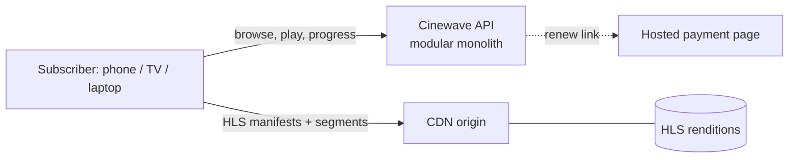

# Cinewave

## Design at a glance
**Brief.** Sahel Pictures (fictional) owns 600 African films that only reach cinemas and festivals. Cinewave is its subscription streaming service: viewers browse what is licensed in their country, press play, and pick up where they stopped on any device.

**Architecture.** A **modular monolith** (Catalogue, Playback, Subscriptions, Profiles) with the video itself on a **CDN** and playback progress as small **idempotent PUTs**. The architecture advisor ranked it first for these traits (read-heavy media, money, personal data, several business areas, five engineers). Microservices only make sense at global scale, and the team is too small to run them. One deployable is cheap to run and easy to hand over. Module boundaries are enforced by tests, so Playback or Catalogue can be pulled out later when progress writes pass about 2,000 per second or browse traffic needs to scale on its own. Full reasoning: [`docs/DESIGN.md`](docs/DESIGN.md).

## Run it in GitHub Codespaces

The dev container installs the SDKs, restores packages and runs every test once on first start. The same setup works locally with VS Code's Dev Containers extension.

| What | Command | Port |
|---|---|---|
| API (Cinewave) | `ASPNETCORE_ENVIRONMENT=Development ASPNETCORE_URLS=http://0.0.0.0:5104 dotnet run --project src/Cinewave.Api` | 5104 |
| Web app | `cd web && npm run dev` | 5173 |
| All tests (same as CI) | `scripts/test-all.sh` | - |

## What it is
Cinewave is an original streaming service for a fictional distributor of African cinema. Every name, film, person and number in it is invented.

The browse screen has a hero title, a "Continue watching" row ("Resume at 12:30 · stopped on your phone") and collection rows. It only shows titles whose licence window covers the viewer's country right now. Pressing Play checks the licence and the subscription, then returns an HLS manifest URL on the CDN origin. The player (hls.js, with native HLS as the fallback) streams from there. Progress is saved every 10 seconds, on pause and on exit, so another device resumes at the same point. If the subscription has lapsed, Play returns 402 with a renew link.

## Run locally
- API: `ASPNETCORE_URLS=http://localhost:5104 ASPNETCORE_ENVIRONMENT=Development dotnet run --project src/Cinewave.Api`
- Web: `cd web && npm ci && npm run dev`, then open http://localhost:5173
- Tests: `dotnet test` and `cd web && npx vitest run`

Details and demo script: `.agentic/runbook.md`.

## How this project is organised
- `src/Cinewave.Api`: composition root (endpoints, ProblemDetails, health checks, local CDN origin at `/cdn`)
- `src/Modules/*`: one project per module; only its `Contracts` are public
- `web/`: React + Vite + TypeScript
- `cdn-origin/`: a tiny invented HLS test pattern
- `.agentic/`: project memory (start with `.agentic/README.md`); AI agents read `AGENTS.md` first

Built with the Baton model from the Agentic Engineering Kit: frame → map → decide → sketch → slice loop → pass the baton.
