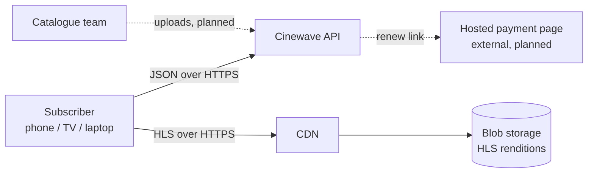
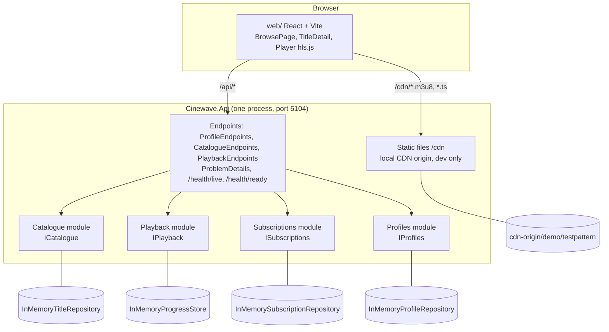
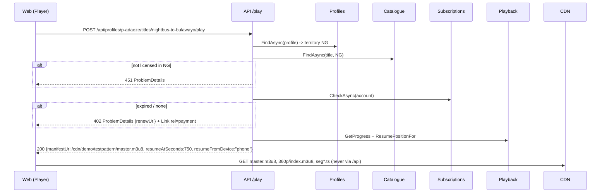
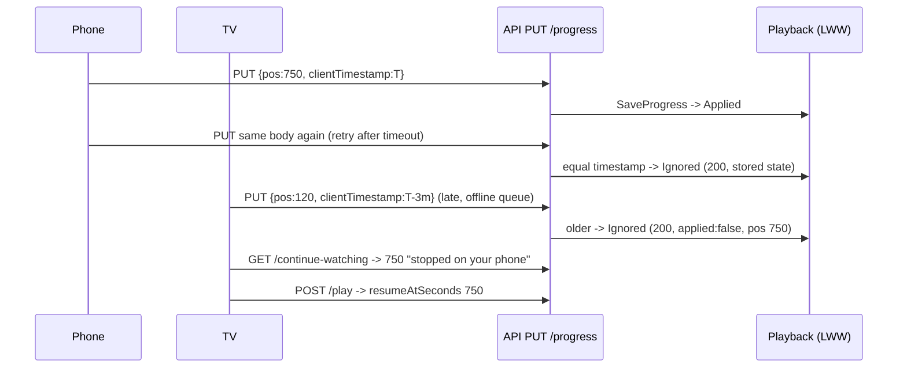
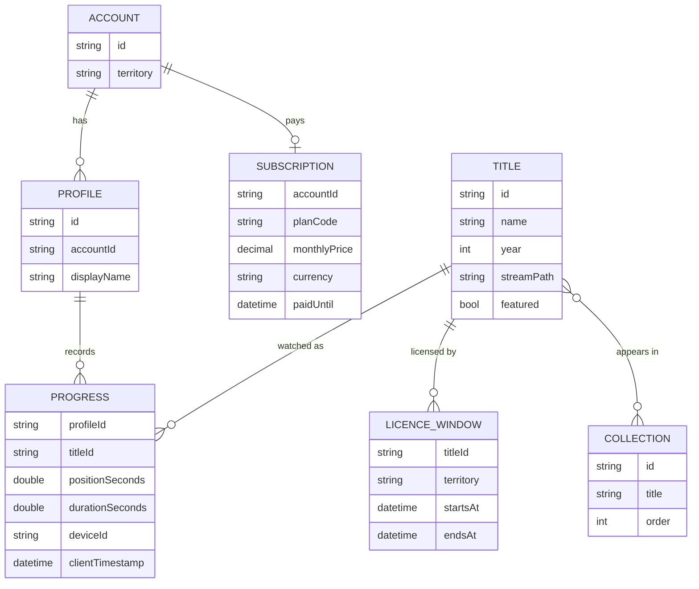

# Cinewave design dossier

> Showcase project. Sahel Pictures and every film, person and number are invented.
> Code state: slice 1 (in-memory stores). Everything marked *planned* is not built yet.

## 1. Brief
- **Client:** Sahel Pictures (fictional), a film distributor launching subscription streaming of African cinema.
- **Problem:** 600 films only reach cinemas and festivals. Audiences at home and abroad can't stream them legally.
- **Users:** subscribers, in the evenings, on phones and smart TVs. The catalogue team uploads weekly.
- **Outcomes:** playback starts in under 2 s. Viewers resume on any device. No video bytes pass through the API servers.
- **Constraints:** licences differ per country, so the catalogue is filtered by territory. Card data never touches our servers.

## 2. Requirements
**Functional (slice 1, done):**
1. A subscriber sees only titles licensed in their territory now (`GET /api/profiles/{id}/browse`).
2. Pressing Play returns an HLS manifest URL on the CDN origin, never an API URL (`POST /api/profiles/{id}/titles/{titleId}/play`).
3. Progress saved on one device resumes at the same second on another (`PUT /api/profiles/{id}/progress/{titleId}`, `GET .../continue-watching`).
4. An expired subscription gets 402 with a renew link.

**Planned:** persistence (slice 2), sign-in, hosted payment and renewal webhook, catalogue uploads.

**Non-functional:**
| Concern | Target | Source |
|---|---|---|
| Time to first frame | p95 < 2 s | product.md |
| `POST /play` latency | p95 < 150 ms | budget inside the 2 s |
| Availability | 99.9% / 30 days | quality.md |
| Licence freshness | a window that closes hides the title on the next request (no cache over 60 s) | licensing contracts (assumption) |
| Progress loss | at most 10 s of position | reporting interval |
| Retention | progress kept while the account exists; deleted on account deletion | POPIA/GDPR |
| Privacy | account holds only id and country; no card data | product.md |

## 3. Capacity estimate
Assumptions (launch): 50,000 subscribers. 40% watch on a given evening. Peak concurrency is 10% of subscribers. Average bitrate is 3 Mbit/s. A film runs about 100 min.
| Quantity | Sum | Result |
|---|---|---|
| Peak concurrent streams | 50,000 × 10% | **5,000** |
| CDN egress at peak | 5,000 × 3 Mbit/s | **15 Gbit/s** (CDN only; API serves 0) |
| Progress writes | 5,000 streams / 10 s | **500 writes/s** (each about 200 bytes) |
| Play requests | 20,000 evening viewers × 3 plays / 4 h peak | about **4/s**, spikes about 50/s at premieres |
| Browse requests | 20,000 × 10 views / 4 h | about **15/s**, spikes about 200/s |
| Media storage | 600 films × 6,000 s × 10 Mbit/s of renditions / 8 | **about 4.5 TB**, plus about 2 TB/year (5 films/week) |
| Progress storage | 50,000 profiles × 30 titles × 200 B | **about 300 MB** |
Global scale (assumption 5M subscribers): 500k concurrent streams, **50,000 progress writes/s**, which is 25 times past the 2,000/s evolution trigger.

## 4. Options considered
`arch-advisor compare MediaDelivery ReadHeavy PersonalData MoneyMovement SeveralBusinessAreas SmallTeam` (launch traits):

| Option | Fit | Complexity (1-5) | Main reason |
|---|---|---|---|
| Modular monolith + CQRS read models | Recommended | 3 | Matches the advisor's recommended style (ModularMonolith). |
| Modular monolith | Good alternative | 3 | Same family as the recommendation (ModularMonolith); a valid variant if its trade-offs suit the team. |
| Event-sourced core with CQRS | Good alternative | 4 | Same family as the recommendation (ModularMonolith); a valid variant if its trade-offs suit the team. |
| Static site + serverless function | Poor fit | 1 | The product has real server-side behaviour and data; a static site can't hold it. |
| Layered monolith | Poor fit | 1 | Several business areas would tangle without module boundaries. |
| Vertical slice monolith | Poor fit | 2 | Several business areas would tangle without module boundaries. |
| Clean Architecture monolith | Poor fit | 2 | Several business areas would tangle without module boundaries. |
| Serverless functions + queues | Poor fit | 3 | Consistency-critical money or stock operations are awkward across stateless functions. |
| Microservices (request/response) | Poor fit | 5 | A small team can't run a distributed system well (deployments, tracing, on-call). |
| Event-driven microservices | Poor fit | 5 | A small team can't run a distributed system well (deployments, tracing, on-call). |
`arch-advisor compare MediaDelivery ReadHeavy GlobalScale PersonalData MoneyMovement` (global-scale traits):

| Option | Fit | Complexity (1-5) | Main reason |
|---|---|---|---|
| Microservices (request/response) | Recommended | 5 | Matches the advisor's recommended style (Microservices). |
| Event-driven microservices | Good alternative | 5 | Same family as the recommendation (Microservices); a valid variant if its trade-offs suit the team. |
| Modular monolith | Possible | 3 | Money: pair it with an append-only ledger and idempotency keys. |
| Modular monolith + CQRS read models | Possible | 3 | Money: pair it with an append-only ledger and idempotency keys. |
| Event-sourced core with CQRS | Possible | 4 | Money: pair it with an append-only ledger and idempotency keys. |
| Static site + serverless function | Poor fit | 1 | The product has real server-side behaviour and data; a static site can't hold it. |
| Layered monolith | Poor fit | 1 | Can't scale the hot part independently, and has no seams to extract it later. |
| Vertical slice monolith | Poor fit | 2 | Can't scale the hot part independently, and has no seams to extract it later. |
| Clean Architecture monolith | Poor fit | 2 | Can't scale the hot part independently, and has no seams to extract it later. |
| Serverless functions + queues | Poor fit | 3 | Consistency-critical money or stock operations are awkward across stateless functions. |
- **Modular monolith (chosen; CQRS read models later):** clear module boundaries without distributed-systems costs, run by five engineers. The read-heavy catalogue gets a cached read model when browse needs it (scaling step 2). Boundaries are enforced by `ModuleBoundaryTests`.
- **Event-sourced core:** complete history isn't a requirement. Progress is "latest position wins", not an audit trail, so event sourcing adds versioning cost for nothing.
- **Microservices (global-scale answer):** the right shape at 500k concurrent streams and several teams. At launch it's a distributed system for 600 titles and five engineers. Module contracts match the future services, so extraction is a deployment change.
- **Serverless + queues:** subscription entitlement and payments need consistency. Cold starts eat into the 2 s start budget.
- **Layered / clean / vertical-slice monolith:** four business areas would tangle without module seams, and none of them gives a seam to extract Playback later.
- **Streaming video through the API** (rejected in ADR-0001): bandwidth cost, and it falls over at the first premiere.
- **Evolution trigger (ADR-0001):** move Playback progress to its own ingestion pipeline when writes pass about 2,000/s. Split Catalogue into a cached read service when browse traffic needs to scale separately.

## 5. Architecture
**C4 context**

**C4 container (as built)**

| Module | Owns | Contract | Calls |
|---|---|---|---|
| Catalogue | titles, collections, licence windows | `BrowseAsync`, `FindAsync` (Available / NotLicensed / NotFound), `AvailableAmongAsync` | nothing |
| Playback | progress per (profile, title), CDN base URL | `SaveProgressAsync` (Applied / Ignored / Invalid), `GetProgressAsync`, `InProgressAsync`, `ResumePositionFor`, `ManifestPathFor` | nothing |
| Subscriptions | subscriptions, plans, `Money` (decimal + ISO currency) | `CheckAsync` -> `Entitlement` + `RenewUrl` | nothing |
| Profiles | accounts (id, territory), profiles | `FindAsync`, `ListAsync` | nothing |
The API endpoints compose modules (for example, play = profile -> catalogue -> subscription -> playback). Modules never reference each other.

## 6. Communication flows
**Play (slice 1, synchronous)**

**Progress and resume on another device (riskiest flow: retries, reordering, clock skew)**

PUT is idempotent by design: the key is (profile, title) and the version is the client timestamp. No Idempotency-Key header is needed. Timestamps more than 5 min ahead of server time are rejected (400), so a bad clock can't win forever. There are no async messages in slice 1. *Planned:* the renewal webhook uses an Idempotency-Key plus a transactional outbox (`SubscriptionRenewed`) so entitlement updates are never lost or doubled.

## 7. Data flow
```mermaid
flowchart LR
  up[Catalogue team upload<br/>planned] --> enc[Encode HLS ladder] --> blob[(Blob / CDN)]
  up --> lic[Licence windows per territory] --> catdb[(Catalogue store)]
  dev[Device] -->|"profile id, device id/name [PD]"| api[API]
  api -->|"position + client timestamp [PD] viewing history"| pdb[(Playback store)]
  api -->|"account territory [PD]"| profdb[(Profiles store)]
  pay[Hosted payment page [$]] -.->|"payment reference + paidUntil, planned"| subdb[(Subscriptions store [$])]
  catdb --> api --> dev
  blob -->|segments| dev
```
[PD] = personal data (POPIA/GDPR). [$] = money: prices as `decimal` `Money`; card numbers never enter the system.

## 8. Data model

| Entities | Module | Consistency |
|---|---|---|
| ACCOUNT, PROFILE | Profiles | strong |
| SUBSCRIPTION | Subscriptions | strong (entitlement read on every play) |
| TITLE, LICENCE_WINDOW, COLLECTION | Catalogue | strong now; eventual (≤ 60 s) once a cached read model exists |
| PROGRESS | Playback | per-key last-write-wins (compare-and-replace under one lock; slice 2: conditional UPDATE on clientTimestamp) |
Cross-module links are ids only: there are no foreign keys across module schemas.

## 9. Scaling path
1. **CDN for media (done by design):** the API serves 0 bytes of video, so 15 Gbit/s never touches it.
2. **Cache browse per territory:** about 8 territories × 5 rows is tiny, so cache for 60 s (licence freshness bound). This covers the premiere spikes.
3. **Postgres per-module schemas (slice 2)**, read replica for Catalogue.
4. **Progress write path:** batch client reports (10 s already), then move Playback to a key-value store partitioned by profile id. At **about 2,000 writes/s** (ADR trigger) extract Playback as a service fed by an ingestion stream.
5. **Catalogue read service** with a search index when browse needs independent scaling.
6. **Multi-region:** CDN is already global. Replicate the catalogue read model per region; keep subscriptions single-writer.

## 10. Failure modes
| Failure | Effect | Mitigation |
|---|---|---|
| CDN / origin down | player can't load segments | hls.js fatal error -> "The stream didn't start", retry; position kept; `/health/ready` checks the origin; multi-CDN later |
| API down | can't browse or start play; running streams continue (CDN) | stateless API behind a load balancer; health checks |
| Duplicate progress PUT (retry) | none | equal timestamp = Ignored, 200 |
| Out-of-order PUT from another device | could rewind position | last write wins by client timestamp |
| Device clock far ahead | its write would win forever | reject > 5 min skew (400) |
| Hot key (premiere: one title) | catalogue reads spike | per-territory browse cache; segments at the CDN edge |
| Licence window ends mid-session | title still playing | play is checked at start; the next browse hides it (test `AC1_licence_window_closing...`) |
| Payment webhook twice *(planned)* | double extension | Idempotency-Key + ledger entries |
| Region outage | API unavailable in that region | CDN keeps serving started streams; second region (scaling step 6) |

## 11. Security and privacy
- **AuthN/Z:** none in slice 1. The profile id is in the path for the demo (known issue in handover.md). Next: OIDC, with the profile id from the token and a check that it belongs to the account.
- **Licensing:** territory comes from the account, not the client. 451 for unlicensed titles. *Planned:* signed CDN cookies so manifest URLs can't be shared across territories.
- **Personal data (POPIA/GDPR):** the account stores only id and country; profiles store a display name; progress is viewing history. All are deletable per account. No personal data in logs.
- **Money:** `decimal` `Money` with an ISO currency. Card data stays on the hosted payment page (402 links there).
- **Secrets:** none in slice 1; `.env.example` lists config keys. CI runs gitleaks and the privacy guard.
- **Threats per flow:** play (URL sharing: signed URLs, planned); progress (spoofed device writes: auth plus the per-profile key); browse (scraping: rate limits, planned).

## 12. Observability
- **SLIs/SLOs** (quality.md): play success 99.9%, TTFF p95 < 2 s, `/play` p95 < 150 ms, browse p95 < 300 ms, progress PUT success 99.5%, 0 video bytes through the API.
- **Key metrics:** plays by outcome (200/402/451), progress outcomes (Applied/Ignored/Invalid), CDN 4xx/5xx and cache hit ratio, client TTFF and rebuffer ratio.
- **Traces:** OpenTelemetry from web -> API -> modules (*planned*; the API uses Sdk.Web only in slice 1).
- **The page-worthy alert:** play-start error budget burning more than 10× over 1 h (5xx on `/play` or manifest 404s).

## 13. Testing strategy
| Layer | Here | Count |
|---|---|---|
| Rules | `LicensingRulesTests`, `ProgressRulesTests`, `EntitlementTests`, `CatalogueServiceTests`, `ProfileServiceTests` | unit |
| Seams / acceptance | `Slice1AcceptanceTests`: real Kestrel on a random port, seeded data, manual `TimeProvider` | 12 |
| Boundaries | `ModuleBoundaryTests`: no module references another; only Contracts are public; InternalsVisibleTo only tests | 4 |
| Web | vitest: timecodes and resume rules, API client (402/451/PUT), ContinueWatchingRow states | 10 |
| Journey | Playwright script run locally (phone pauses at 12:30 -> TV resumes at 12:31 via hls.js; expired -> paywall); CI e2e planned | 1 |
Criteria to tests: AC1 -> `AC1_*` (3), AC2 -> `AC2_*` (2), AC3 -> `AC3_*` (3), AC4 -> `AC4_*` (2). Total offline .NET run: 49 passing.

## 14. Interview questions
1. **Why not stream video through the API?** 15 Gbit/s at launch peak. The API would need dozens of instances, and premieres would melt it. A CDN is cheaper, closer to viewers and already global. The API only issues a URL.
2. **What if a progress PUT is retried or arrives late?** The key is (profile, title) and the version is the client timestamp. Equal timestamp is a replay (no-op); older is ignored; the response always returns the stored state.
3. **Why client time and not server time?** The order that matters is the order the viewer watched in. An offline TV flushing old reports must not overwrite the phone. Skew over 5 min is rejected.
4. **How do you scale progress to 50,000 writes/s?** Partition by profile id in a key-value store with conditional writes, then extract Playback behind an ingestion stream. The ADR trigger is 2,000/s.
5. **How is licensing enforced?** Territory comes from the account. Windows are [start, end) per territory, checked at browse and play time with an injected clock. Planned signed CDN cookies stop URL sharing.
6. **What happens when a subscription lapses mid-film?** The current stream continues (the entitlement check is at play start). The next play gets 402 with a renew link to the hosted payment page.
7. **How do you stop the monolith becoming a ball of mud?** Each module exposes only Contracts and a registration class. Reflection tests fail the build if a module references another or leaks internals.
8. **What breaks first at 10× traffic?** Browse at premieres: add the per-territory 60 s cache. Then the progress write path.
9. **How would you add recommendations?** As a new module that reads Playback progress through its contract, or an outbox event once one exists. It writes a per-profile row that Catalogue's browse can include.
